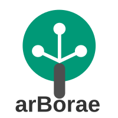
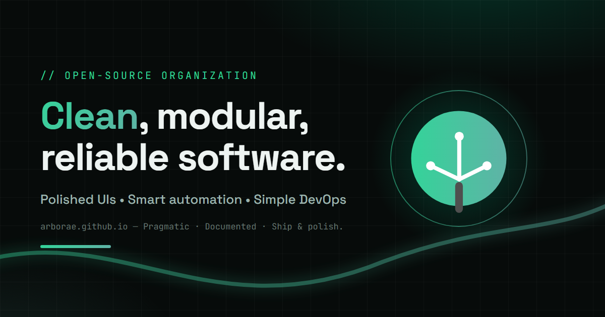

<p align="center">
  
</p>

<h1 align="center">arborae.github.io</h1>

<p align="center"><strong>Official website of Arborae</strong> — the open-source org for clean, modular, reliable software.<br>
Dark-first, responsive, zero build step.</p>

<p align="center">
  <a href="https://arborae.github.io"></a>
  
  
  <a href="https://github.com/arborae"></a>
  <a href="LICENSE"></a>
</p>

<p align="center">
  <a href="https://arborae.github.io"></a>
</p>

<p align="center"><strong>🌐 Live: <a href="https://arborae.github.io">arborae.github.io</a></strong></p>

---

## ✨ Highlights

- 🌱 **Org landing** — one page presenting Arborae: featured projects, web tools, principles, founders and community links.
- 🧰 **Tools auto-index** — public Arborae repositories tagged with `arborae-page` (or `arborae-pagina`) are indexed automatically into `assets/tools.json` and rendered with category filters.
- 🌍 **English & Italian** — English by default, Italian with the IT/EN switch (or automatically for browsers set to Italian); the choice is remembered.
- 🌙 **Dark-first** design with a subtle animated grid and a terminal mock in the hero.
- ⚡ **Zero build step** — plain HTML + CSS + vanilla JS (`assets/i18n.js`, `assets/tools.js`).
- 📱 **Responsive & accessible** — mobile-friendly layout, `prefers-reduced-motion` aware animations, ARIA labels.
- 🔍 **SEO & social ready** — description, Open Graph + Twitter cards, social preview image and an SVG favicon.

## 🧱 Tech stack

- **HTML5** (single page, semantic)
- **CSS3** — custom properties, grid/flex, dark theme, no framework
- **Vanilla JS** (`assets/i18n.js`, `assets/tools.js`) — EN/IT translations, footer year, reveal-on-scroll and dynamic Tools grid
- **Indexer**: Python 3 stdlib (`scripts/update_tools.py`) + GitHub Actions (`.github/workflows/update-tools.yml`)
- **Fonts**: Space Grotesk · Inter · JetBrains Mono (Google Fonts)
- **Hosting**: GitHub Pages (deploy from `main`, root)

## 🧩 Project structure

```
index.html                   the whole landing page (hero, projects, tools, principles, founders, community), in English
style.css                    dark-first stylesheet
assets/
  i18n.js                    EN/IT dictionary + language switch, footer year, reveal-on-scroll
  tools.js                   fetches assets/tools.json, builds category filters and tool cards safely via DOM APIs
  tools.json                 auto-generated index of Arborae public web tools
  logo.svg                   Arborae logo
  banner.svg                 banner artwork
  favicon.svg                site icon
  social-preview.*           Open Graph image (.png) + its source (.html / .svg)
scripts/
  update_tools.py            stdlib Python script querying the GitHub API to refresh assets/tools.json
.github/workflows/
  update-tools.yml           scheduled & dispatch workflow keeping assets/tools.json up to date
docs/
  CHANGELOG.md               structural change log
```

## 🧰 Tools auto-index

Any public, non-archived, non-template repository in the `Arborae` GitHub organization tagged with the `arborae-page` (or `arborae-pagina`) topic is indexed automatically into `assets/tools.json`:

- Additional repository topics become filterable category badges on the landing page.
- Live URL resolves from the repository `homepage` field (if `http://` or `https://`), otherwise `https://arborae.github.io/<repo>/` when GitHub Pages is enabled, or the repository URL as fallback.
- `.github/workflows/update-tools.yml` refreshes `assets/tools.json` daily (`03:00 UTC`), on `workflow_dispatch`, or on `repository_dispatch` (`tools-updated`).

To preview or update the index locally (no external dependencies):

```bash
python3 scripts/update_tools.py --dry-run
python3 scripts/update_tools.py
```

## 🛠️ Run locally

It's a static site — no dependencies. Serve the folder over HTTP:

```bash
git clone https://github.com/arborae/arborae.github.io.git
cd arborae.github.io
python -m http.server 8000        # → http://localhost:8000
```

## 🚀 Deploy (GitHub Pages)

Served straight from the repository, no pipeline:

1. Repo → **Settings → Pages**
2. **Source**: *Deploy from a branch*
3. **Branch**: `main` · **Folder**: `/ (root)`

Every push to `main` is published to **https://arborae.github.io** within a minute or two.

## 🌳 About Arborae

**ARBORAE** — *Adaptive Reconfigurable Backbone for Optimized Resource Automation and Energy Efficiency.*
An open-source organization focused on modular software, Home Assistant, automation, DevOps and modern UI,
co-founded by [@giosci1994](https://github.com/giosci1994) and [@chopin94](https://github.com/chopin94).

- 🧩 Flagship project: [**d2ha — docker2homeassistant**](https://github.com/arborae/docker2homeassistant)
- 💬 [Discussions](https://github.com/orgs/arborae/discussions) · 🛡️ [Security policy](https://github.com/arborae/.github/blob/main/SECURITY.md) · 🤝 [Contributing](https://github.com/arborae/.github/blob/main/CONTRIBUTING.md)

## 📄 License

The **source code** (HTML/CSS/JS) is released under the [GNU GPLv3 License](LICENSE).

> ℹ️ The **Arborae name, logo and branding** (`assets/logo.svg`, `assets/banner.svg`) are property of the Arborae organization — please don't reuse them to represent a different project.

---

<p align="center"><sub>© 2026 Arborae · clean, modular, reliable software</sub></p>
