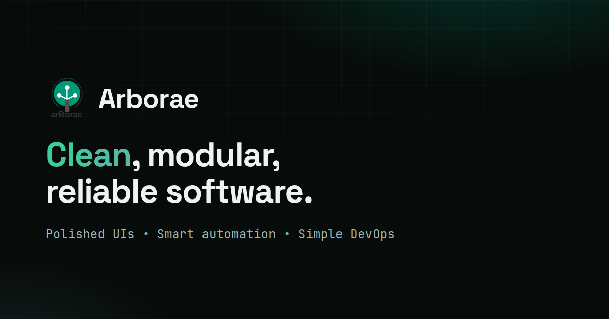

<p align="center">
  
</p>

<h1 align="center">arborae.github.io</h1>

<p align="center"><strong>Official website of Arborae</strong> — the open-source org for clean, modular, reliable software.<br>
Dark-first, responsive, zero build step.</p>

<p align="center">🇬🇧 English · <a href="#-italiano">🇮🇹 Italiano</a></p>

<p align="center">
  <a href="https://arborae.github.io"></a>
  
  
  <a href="https://github.com/arborae"></a>
  <a href="LICENSE"></a>
</p>

<p align="center">
  <a href="https://arborae.github.io"></a>
</p>

<p align="center"><strong>🌐 Live: <a href="https://arborae.github.io">arborae.github.io</a></strong></p>

---

## ✨ Highlights

- 🌱 **Org landing** — one page presenting Arborae: featured projects, principles, founders and community links.
- 🌍 **English & Italian** — English by default, Italian with the IT/EN switch (or automatically for browsers set to Italian); the choice is remembered.
- 🌙 **Dark-first** design with a subtle animated grid and a terminal mock in the hero.
- ⚡ **Zero build step** — plain HTML + CSS + a small vanilla JS file (translations, year + `IntersectionObserver` reveals).
- 📱 **Responsive & accessible** — mobile-friendly layout, `prefers-reduced-motion` aware animations, ARIA labels.
- 🔍 **SEO & social ready** — description, Open Graph + Twitter cards, social preview image and an SVG favicon.

## 🧱 Tech stack

- **HTML5** (single page, semantic)
- **CSS3** — custom properties, grid/flex, dark theme, no framework
- **Vanilla JS** (`assets/i18n.js`) — EN/IT translations, footer year + reveal-on-scroll
- **Fonts**: Space Grotesk · Inter · JetBrains Mono (Google Fonts)
- **Hosting**: GitHub Pages (deploy from `main`, root)

## 🧩 Project structure

```
index.html          the whole landing page (hero, projects, principles, founders, community), in English
style.css           dark-first stylesheet
assets/
  i18n.js           EN/IT dictionary + language switch, footer year, reveal-on-scroll
  logo.svg          Arborae logo
  banner.svg        banner artwork
  favicon.svg       site icon
  social-preview.*  Open Graph image (.png) + its source (.html / .svg)
```

## 🛠️ Run locally

It's a static site — no dependencies. Serve the folder over HTTP:

```bash
git clone https://github.com/arborae/arborae.github.io.git
cd arborae.github.io
python -m http.server 8000        # → http://localhost:8000
```

## 🚀 Deploy (GitHub Pages)

Served straight from the repository, no pipeline:

1. Repo → **Settings → Pages**
2. **Source**: *Deploy from a branch*
3. **Branch**: `main` · **Folder**: `/ (root)`

Every push to `main` is published to **https://arborae.github.io** within a minute or two.

## 🌳 About Arborae

**ARBORAE** — *Adaptive Reconfigurable Backbone for Optimized Resource Automation and Energy Efficiency.*
An open-source organization focused on modular software, Home Assistant, automation, DevOps and modern UI,
co-founded by [@giosci1994](https://github.com/giosci1994) and [@chopin94](https://github.com/chopin94).

- 🧩 Flagship project: [**d2ha — docker2homeassistant**](https://github.com/arborae/docker2homeassistant)
- 💬 [Discussions](https://github.com/orgs/arborae/discussions) · 🛡️ [Security policy](https://github.com/arborae/.github/blob/main/SECURITY.md) · 🤝 [Contributing](https://github.com/arborae/.github/blob/main/CONTRIBUTING.md)

## 📄 License

The **source code** (HTML/CSS/JS) is released under the [GNU GPLv3 License](LICENSE).

> ℹ️ The **Arborae name, logo and branding** (`assets/logo.svg`, `assets/banner.svg`) are property of the Arborae organization — please don't reuse them to represent a different project.

<br>

---
---

<a id="-italiano"></a>

# 🇮🇹 Italiano

**Sito ufficiale di Arborae** — l'organizzazione open source per software pulito, modulare e affidabile.
Dark-first, responsive, zero build step.

<p align="center"><strong>🌐 Online: <a href="https://arborae.github.io">arborae.github.io</a></strong></p>

## ✨ In breve

- 🌱 **Landing dell'org** — una pagina che presenta Arborae: progetti in evidenza, principi, founders e link alla community.
- 🌍 **Inglese e italiano** — inglese di default, italiano con il selettore IT/EN (o in automatico per i browser in italiano); la scelta viene ricordata.
- 🌙 Design **dark-first** con griglia animata discreta e un mock di terminale nell'hero.
- ⚡ **Zero build step** — solo HTML + CSS + un piccolo file JS vanilla (traduzioni, anno + reveal con `IntersectionObserver`).
- 📱 **Responsive e accessibile** — layout mobile-friendly, animazioni che rispettano `prefers-reduced-motion`, label ARIA.
- 🔍 **Pronto per SEO e social** — description, Open Graph + Twitter card, immagine social e favicon SVG.

## 🧱 Stack

- **HTML5** (single page, semantico)
- **CSS3** con custom properties, grid/flex, tema scuro, nessun framework
- **JS vanilla** (`assets/i18n.js`) — traduzioni EN/IT, anno del footer + reveal allo scroll
- **Font**: Space Grotesk · Inter · JetBrains Mono (Google Fonts)
- **Hosting**: GitHub Pages (deploy dal branch `main`, root)

## 🧩 Struttura

- `index.html` — l'intera landing (hero, progetti, principi, founders, community), in inglese
- `style.css` — foglio di stile dark-first
- `assets/i18n.js` — dizionario EN/IT e selettore di lingua, anno del footer, reveal allo scroll
- `assets/` — logo, banner, favicon e immagine di social preview (+ sorgenti)

## 🛠️ Avvio in locale

È un sito statico, nessuna dipendenza. Servilo via HTTP:

```bash
git clone https://github.com/arborae/arborae.github.io.git
cd arborae.github.io
python -m http.server 8000        # → http://localhost:8000
```

## 🚀 Deploy (GitHub Pages)

Servito direttamente dal repository, senza pipeline:

1. Repo → **Settings → Pages**
2. **Source**: *Deploy from a branch*
3. **Branch**: `main` · **Cartella**: `/ (root)`

Ogni push su `main` viene pubblicato su **https://arborae.github.io** in un paio di minuti.

## 🌳 Cos'è Arborae

**ARBORAE** — *Adaptive Reconfigurable Backbone for Optimized Resource Automation and Energy Efficiency.*
Organizzazione open source focalizzata su software modulare, Home Assistant, automazione, DevOps e UI moderna,
co-fondata da [@giosci1994](https://github.com/giosci1994) e [@chopin94](https://github.com/chopin94).

## 📄 Licenza

Il **codice sorgente** (HTML/CSS/JS) è rilasciato con [licenza GNU GPLv3](LICENSE).

> ℹ️ Il **nome, il logo e il branding di Arborae** (`assets/logo.svg`, `assets/banner.svg`) sono dell'organizzazione Arborae — non riutilizzarli per rappresentare un progetto diverso.

---

<p align="center"><sub>© 2026 Arborae · software pulito, modulare e affidabile</sub></p>
